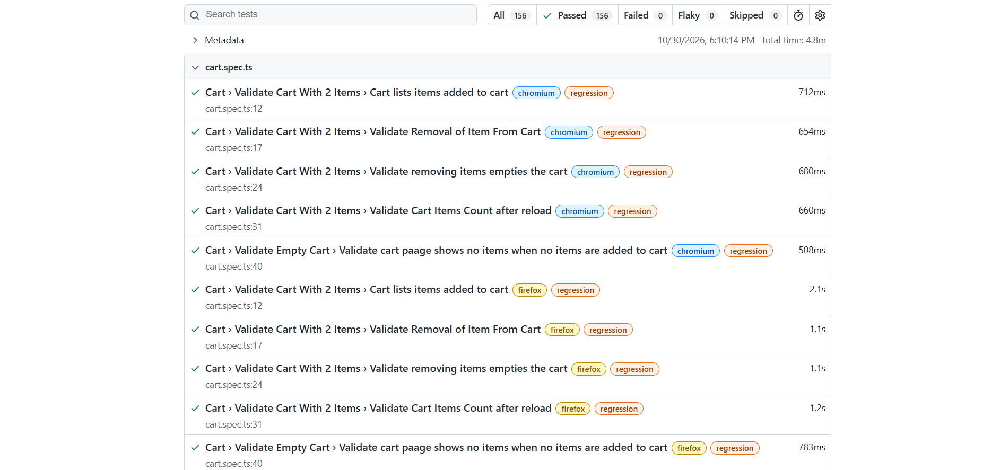

# Sauce Demo Playwright Framework

[](https://github.com/beldeirawi01/sauce-demo-playwright-framework/actions/workflows/playwright.yml)

End-to-end test framework for [SauceDemo](https://www.saucedemo.com), built with **Playwright + TypeScript** and the **Page Object Model**. It covers login, product browsing and sorting, the cart, checkout, logout, and the site's built-in user personas, and it publishes an HTML report from CI.

**Live report:** https://beldeirawi01.github.io/sauce-demo-playwright-framework/ (updated on every push to `master`)



## Tech Stack

- **Playwright** running on Chromium, Firefox and WebKit
- **TypeScript** for page objects, fixtures and test data
- **Page Object Model** with locators and actions in `pages/`, assertions in `tests/`
- **Custom fixtures** that create page objects and log in for you
- **GitHub Actions** to run the suite and publish the report to GitHub Pages

## Project Structure

```
├── pages/                     # Page objects: locators and actions, no assertions
│   ├── LoginPage.ts
│   ├── InventoryPage.ts       # also holds sorting and logout
│   ├── CartPage.ts
│   └── CheckoutPage.ts
├── test-data/
│   ├── LoginData.ts           # valid users, invalid credentials, expected errors
│   └── CheckoutData.ts        # valid and invalid customer details
├── tests/
│   ├── fixtures.ts            # loginPage, inventoryPage (logged in), cartPage, checkoutPage
│   ├── login.spec.ts
│   ├── inventory.spec.ts      # inventory, sorting, logout
│   ├── cart.spec.ts
│   ├── checkout.spec.ts
│   └── users.spec.ts          # built-in user types
├── .github/workflows/playwright.yml
├── playwright.config.ts
└── tsconfig.json
```

## How to Run

Install once:

```bash
npm install
npx playwright install --with-deps
```

Optional `.env` (the suite falls back to SauceDemo's public defaults without it):

```
BASE_URL=https://www.saucedemo.com
```

| Command | What it does |
| --- | --- |
| `npx playwright test` | Everything, on all 3 browsers |
| `npm run test:smoke` | Only `@smoke` tests (critical path) |
| `npm run test:regression` | Only `@regression` tests |
| `npx playwright test --project=chromium` | Everything, Chromium only |
| `npx playwright test tests/cart.spec.ts` | One file |
| `npx playwright test -g "Logout"` | Tests whose name matches |
| `npx playwright show-report` | Open the last HTML report |

On Windows PowerShell, use the npm scripts for tags. Typing `--grep @smoke` directly can fail because of how PowerShell treats `@`.

## Test Plan

**Scope.** Customer-facing flows on SauceDemo: authentication, product list and sorting, cart management, checkout, logout and session handling, and the built-in user personas.

**Out of scope.** Performance and load testing, accessibility audits, visual regression, mobile viewports, and API testing (SauceDemo has no API).

**Approach**
- Black-box UI tests through page objects. Assertions live in the specs, not the page objects.
- Every test is independent and starts from a fresh browser context. Setup (login, adding items to the cart) is handled by fixtures or `beforeEach`.
- Assertions use Playwright's auto-retrying checks (`toHaveURL`, `toHaveText`, `toHaveCount`), not one-time reads like `page.url()`.
- Test data lives in `test-data/`, so a new case is usually a new data row.
- Tests are tagged by purpose: **`@smoke`** for the critical path and **`@regression`** for everything else. A test carries one tag or the other.

**Entry and exit.** Entry: the site is reachable and dependencies are installed. Exit: all tests pass on all 3 browsers. Tests marked as known defects count as passing while the defect exists.

**Known defects.** `problem_user` has products whose Add or Remove button does not work. The per-product test in `users.spec.ts` lists those products in `brokenProducts` and marks them with `test.fail()`. The suite stays green while the bug exists, and a listed test turns red if the site ever fixes it, which tells you to update the list.

## Coverage Summary

52 tests across 3 browsers = 156 executions. 6 tests are `@smoke` (18 executions) and 46 are `@regression` (138 executions).

| Area | Spec | Tests | Covers |
| --- | --- | ---: | --- |
| Login | `login.spec.ts` | 9 | valid login; locked-out user; wrong password; empty username; empty password; unknown username; wrong-case username; error banner dismissal; direct access to the inventory page without logging in |
| Inventory | `inventory.spec.ts` | 5 | page title and 6 products; add to cart; add all items; remove from cart; cart navigation |
| Sorting | `inventory.spec.ts` | 4 | name A to Z and Z to A; price low to high and high to low |
| Logout | `inventory.spec.ts` | 1 | logout returns to the login page |
| Cart | `cart.spec.ts` | 5 | names match what was added; remove one item; remove all items; cart survives a reload; empty cart |
| Checkout | `checkout.spec.ts` | 20 | cart page; customer info validation; order overview; order completion; end-to-end flow |
| Built-in users | `users.spec.ts` | 8 | `performance_glitch_user` slow login; `problem_user` login and per-product Add/Remove with known defects |

`locked_out_user` is covered in `login.spec.ts`.

## Reporting

- An **HTML report** is generated on every run (`playwright-report/`).
- **On failure** the report includes a screenshot and a full trace (DOM snapshots, network and console for every step).
- **In CI** the report is uploaded as a build artifact and published to GitHub Pages.

## CI/CD

`.github/workflows/playwright.yml` runs on every push and pull request to `main`/`master`:

1. `npm ci`, then install the Playwright browsers
2. Run the full suite on Chromium, Firefox and WebKit
3. Upload the HTML report as an artifact (kept 30 days)
4. A second job, `publish-report`, deploys the report to GitHub Pages. It is skipped on pull requests and runs even when tests fail, so a failing run still has a report.

`BASE_URL` and the user and password overrides come from repository secrets. Blank or missing secrets fall back to SauceDemo's defaults. Publishing needs **Settings → Pages → Source: GitHub Actions**, set once.

## Design Decisions

- **Page Object Model.** Locators and actions live in `pages/`, and tests read as user steps. A UI change is fixed in one place.
- **`data-test` locators.** SauceDemo's automation hook is more stable than CSS classes.
- **Fixtures.** `inventoryPage` logs in as `standard_user` before the test starts, so specs don't repeat login steps.
- **Data-driven tests.** Credentials, error messages and customer details live in `test-data/`. The `problem_user` Add/Remove test is generated from a product list.
- **Waiting assertions.** `expect(locator)` checks retry until they pass or time out. Early versions that used `.count()` or `page.url()` were flaky across browsers, and switching fixed them.
- **Known defects as tests.** `test.fail()` keeps real site defects visible without breaking the build.

## Future Improvements

- Cover `error_user` and `visual_user` behaviour beyond login
- More `problem_user` defects
- Visual regression checks for `visual_user`
- Accessibility checks with `@axe-core/playwright`
- Mobile viewport projects
- Sharding in CI as the suite grows
- Allure reporting for trend history
