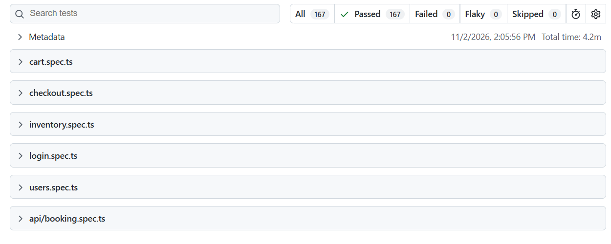

# Sauce Demo Playwright Framework

[](https://github.com/beldeirawi01/sauce-demo-playwright-framework/actions/workflows/playwright.yml)

End-to-end test framework built with **Playwright + TypeScript** and the **Page Object Model**. The UI suite targets [SauceDemo](https://www.saucedemo.com) and covers login, product browsing and sorting, the cart, checkout, logout, and the site's built-in user personas. A small API suite in the same repo targets the public practice API [Restful-booker](https://restful-booker.herokuapp.com). Everything runs in one CI pipeline and publishes one HTML report.

**Live report:** https://beldeirawi01.github.io/sauce-demo-playwright-framework/ (updated on every push to `master`)



## Tech Stack

- **Playwright** running UI tests on Chromium, Firefox and WebKit
- **Playwright's built-in API testing** (the `request` fixture) for the API suite, with no browser needed
- **TypeScript** for page objects, fixtures and test data
- **Page Object Model** with locators and actions in `pages/`, assertions in `tests/`
- **Custom fixtures** that create page objects and log in for you
- **GitHub Actions** to run the suite and publish the report to GitHub Pages

## Project Structure

```
├── pages/                     # Page objects: locators and actions, no assertions
│   ├── LoginPage.ts
│   ├── InventoryPage.ts       # also holds sorting and logout
│   ├── CartPage.ts
│   └── CheckoutPage.ts
├── test-data/
│   ├── LoginData.ts           # valid users, invalid credentials, expected errors
│   └── CheckoutData.ts        # valid and invalid customer details
├── tests/
│   ├── fixtures.ts            # loginPage, inventoryPage (logged in), cartPage, checkoutPage
│   ├── login.spec.ts
│   ├── inventory.spec.ts      # inventory, sorting, logout
│   ├── cart.spec.ts
│   ├── checkout.spec.ts
│   ├── users.spec.ts          # built-in user types
│   └── api/
│       └── booking.spec.ts    # Restful-booker API tests (no browser)
├── .github/workflows/playwright.yml
├── playwright.config.ts       # 3 browser projects for UI, 1 "api" project
└── tsconfig.json
```

## How to Run

Install once:

```bash
npm install
npx playwright install --with-deps
```

Optional `.env` (the suite falls back to public defaults without it):

```
BASE_URL=https://www.saucedemo.com
API_BASE_URL=https://restful-booker.herokuapp.com
```

| Command | What it does |
| --- | --- |
| `npx playwright test` | Everything: UI on 3 browsers plus the API suite |
| `npm run test:smoke` | Only `@smoke` UI tests (critical path) |
| `npm run test:regression` | Only `@regression` UI tests |
| `npm run test:api` | Only the API suite |
| `npx playwright test --project=chromium` | UI tests on Chromium only |
| `npx playwright test tests/cart.spec.ts` | One file |
| `npx playwright test -g "Logout"` | Tests whose name matches |
| `npx playwright show-report` | Open the last HTML report |

On Windows PowerShell, use the npm scripts for tags. Typing `--grep @smoke` directly can fail because of how PowerShell treats `@`.

## Test Plan

**Scope.** Customer-facing flows on SauceDemo: authentication, product list and sorting, cart management, checkout, logout and session handling, and the built-in user personas. For the API, Restful-booker's authentication, booking CRUD and negative cases.

**Out of scope.** Performance and load testing, accessibility audits, visual regression, and mobile viewports. SauceDemo has no backend API of its own, which is why the API suite uses a separate public practice API.

**Approach**
- Black-box UI tests through page objects. Assertions live in the specs, not the page objects.
- Every test is independent and starts from a fresh browser context. Setup (login, adding items to the cart) is handled by fixtures or `beforeEach`.
- Assertions use Playwright's auto-retrying checks (`toHaveURL`, `toHaveText`, `toHaveCount`), not one-time reads like `page.url()`.
- Test data lives in `test-data/`, so a new case is usually a new data row.
- UI tests are tagged by purpose: **`@smoke`** for the critical path and **`@regression`** for everything else. A test carries one tag or the other. API tests carry **`@api`**.
- **API tests create their own data.** The public Restful-booker instance is shared and resets itself on a timer, so no test depends on a booking that already exists. Update and delete tests create a booking first, and read it back afterward to prove the change happened.
- The API token is requested per test and sent in a `Cookie` header, which is the only way this API accepts it.

**Entry and exit.** Entry: both sites are reachable and dependencies are installed. Exit: all tests pass. Tests marked as known defects count as passing while the defect exists.

**Known defects.** Each one is written as a test that asserts the correct behavior and is marked with `test.fail()`. The suite stays green while the bug exists, and a test turns red if the site is ever fixed, which tells you to update it.
- **SauceDemo `problem_user`:** some products' Add or Remove buttons do not work. These are listed in `brokenProducts` in `users.spec.ts`.
- **Restful-booker, bad credentials:** a wrong password returns `200` with a `reason` message instead of a `401`.
- **Restful-booker, missing required field:** creating a booking without a first name returns `500` instead of a `4xx` validation error.

## Coverage Summary

63 tests: 52 UI tests across 3 browsers (156 executions) plus 11 API tests, for 167 executions in total. Of the UI tests, 6 are `@smoke` (18 executions) and 46 are `@regression` (138 executions).

| Area | Spec | Tests | Covers |
| --- | --- | ---: | --- |
| Login | `login.spec.ts` | 9 | valid login; locked-out user; wrong password; empty username; empty password; unknown username; wrong-case username; error banner dismissal; direct access to the inventory page without logging in |
| Inventory | `inventory.spec.ts` | 5 | page title and 6 products; add to cart; add all items; remove from cart; cart navigation |
| Sorting | `inventory.spec.ts` | 4 | name A to Z and Z to A; price low to high and high to low |
| Logout | `inventory.spec.ts` | 1 | logout returns to the login page |
| Cart | `cart.spec.ts` | 5 | names match what was added; remove one item; remove all items; cart survives a reload; empty cart |
| Checkout | `checkout.spec.ts` | 20 | cart page; customer info validation; order overview; order completion; end-to-end flow |
| Built-in users | `users.spec.ts` | 8 | `performance_glitch_user` slow login; `problem_user` login and per-product Add/Remove with known defects |
| API | `tests/api/booking.spec.ts` | 11 | auth (valid login, wrong password); create, read, update and delete a booking; update and delete without a token rejected with `403`; validation error on create |

`locked_out_user` is covered in `login.spec.ts`. API tests run once each because they use no browser.

## Reporting

- An **HTML report** is generated on every run (`playwright-report/`).
- **On failure** the report includes a screenshot and a full trace (DOM snapshots, network and console for every step).
- **In CI** the report is uploaded as a build artifact and published to GitHub Pages. UI and API results appear together in the same report, and API tests are labeled with the `api` project instead of a browser.

## CI/CD

`.github/workflows/playwright.yml` runs on every push and pull request to `main`/`master`:

1. `npm ci`, then install the Playwright browsers
2. Run every Playwright project: UI on Chromium, Firefox and WebKit, plus the API suite
3. Upload the HTML report as an artifact (kept 30 days)
4. A second job, `publish-report`, deploys the report to GitHub Pages. It is skipped on pull requests and runs even when tests fail, so a failing run still has a report.

`BASE_URL` and the user and password overrides come from repository secrets. Blank or missing secrets fall back to the public defaults. Publishing needs **Settings → Pages → Source: GitHub Actions**, set once. The API suite depends on a public third-party service, so an outage there can fail the API tests while the UI tests stay green.

## Design Decisions

- **Page Object Model.** Locators and actions live in `pages/`, and tests read as user steps. A UI change is fixed in one place.
- **`data-test` locators.** SauceDemo's automation hook is more stable than CSS classes.
- **Fixtures.** `inventoryPage` logs in as `standard_user` before the test starts, so specs don't repeat login steps.
- **Data-driven tests.** Credentials, error messages and customer details live in `test-data/`. The `problem_user` Add/Remove test is generated from a product list.
- **Waiting assertions.** `expect(locator)` checks retry until they pass or time out. Early versions that used `.count()` or `page.url()` were flaky across browsers, and switching fixed them.
- **One framework for UI and API.** The API suite is a separate Playwright project in the same repo, so one command, one CI workflow and one report cover both.
- **Self-contained API tests.** Helpers create the data each test needs, so tests don't depend on a shared service's current contents.
- **Known defects as tests.** `test.fail()` keeps real defects visible without breaking the build.

## Future Improvements

- Move API requests into reusable classes (an `api/` folder, like `pages/`) and add payload data files
- Validate API response schemas
- Cover `error_user` and `visual_user` behaviour beyond login
- More `problem_user` defects
- Visual regression checks for `visual_user`
- Accessibility checks with `@axe-core/playwright`
- Mobile viewport projects
- Sharding in CI as the suite grows
- Allure reporting for trend history